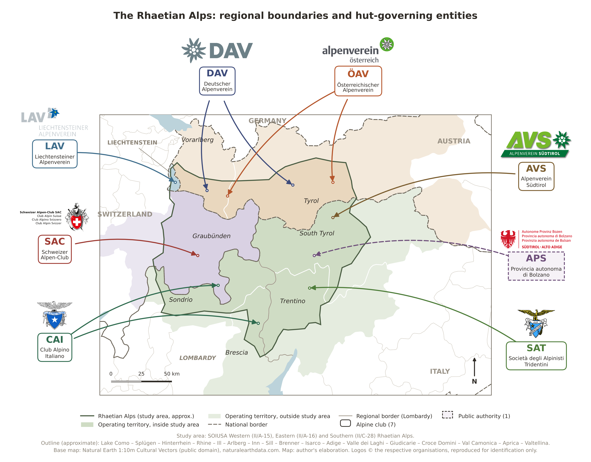

# MAPPA_RETICHE

Source code for **Figure 1: The Rhaetian Alps: regional boundaries and hut-governing entities**
(PhD thesis, *Food Heritage: Cultures and Identities*, University of Coimbra).



The map shows the study area (SOIUSA sections II/A-15 Western, II/A-16 Eastern and
II/C-28 Southern Rhaetian Alps) and the administrative territories in which eight
hut-governing entities (seven alpine clubs and one public authority) own or operate huts.

## Contents

| Path | What it is |
|---|---|
| `rhaetian_map.py` | The script. All settings (outline, territories, labels, colours) are in its CONFIG section. |
| `ne_data/` | Natural Earth 1:10m boundaries, trimmed to the Alpine area (7.5–14.2°E, 44.3–48.9°N). |
| `logos/` | Entity logos (PNG, trimmed), named by entity key: LAV, SAC, CAI, DAV, OEAV, AVS, APS, SAT. |
| `output/` | The rendered figure (PDF, PNG at 300 dpi, SVG). |
| `requirements.txt` | Python dependencies (matplotlib only). |

## Running it

```bash
pip install -r requirements.txt
cd output
python ../rhaetian_map.py ../ne_data --out F1_Rhaetian_alps_map
```

Logos are read from `logos/` next to the script and drawn above each entity's box.
Use `--logos other/folder` to point elsewhere, or `--logos none` for a version without logos.

## Method notes

- **Study area.** The outline is digitised manually as about 65 points along the limits of the
  SOIUSA sections (Marazzi 2005), placed at towns, passes and river confluences. It is
  approximate (a few km) and not an official SOIUSA boundary dataset.
- **Projection.** Equirectangular, with longitude scaled by the cosine of the map's middle
  latitude (≈46.6°N). The scale bar is therefore approximate.
- **Shading.** Each operating territory is shown pale in full, and in full colour where it lies
  inside the study area.

## Sources and licences

- Base map: [Natural Earth](https://www.naturalearthdata.com) 1:10m Cultural Vectors, public domain.
- Section limits: Marazzi, S. (2005). *Atlante orografico delle Alpi. SOIUSA*. Pavone Canavese: Priuli & Verlucca.
- Logos: © the respective organisations (DAV, ÖAV, LAV, SAC, CAI, AVS, SAT, Autonome Provinz Bozen – Südtirol), reproduced for identification only. They are **not** covered by the code licence.
- Code: GNU GPL v3 or later (see `LICENSE`).
