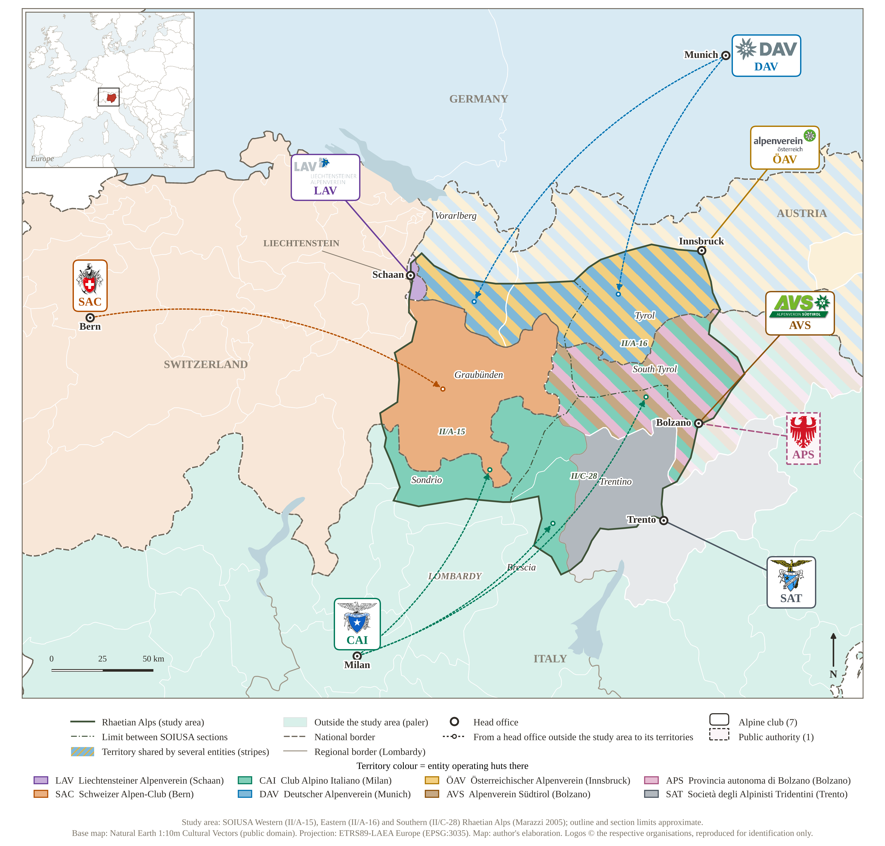
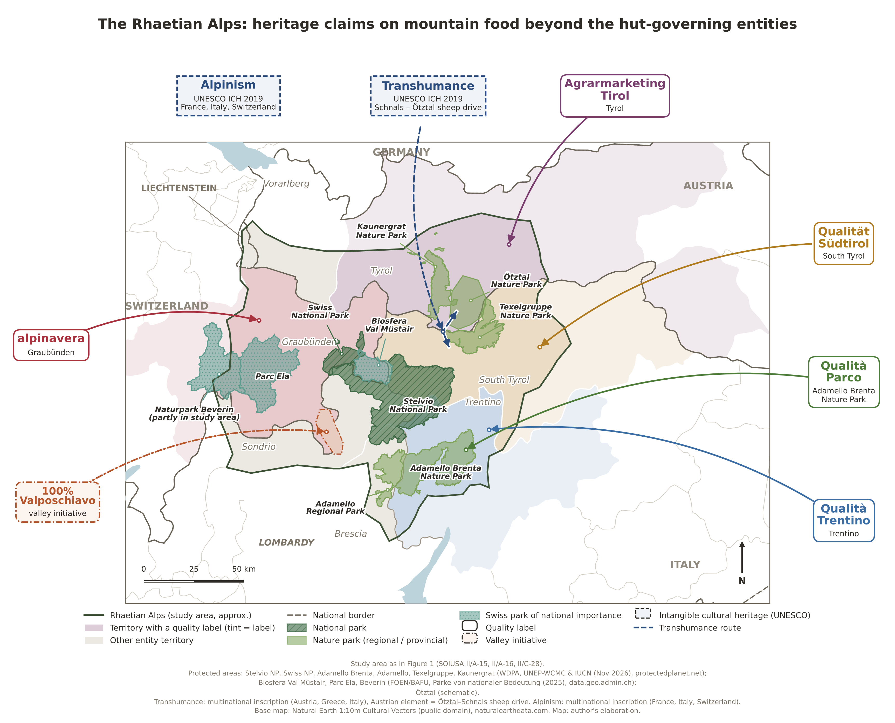

# MAPPA_RETICHE

Source code for three maps of the PhD thesis (*Food Heritage: Cultures and Identities*, University of Coimbra):

- **Figure 1: The Rhaetian Alps: regional boundaries and hut-governing entities** (`rhaetian_map.py`)
- **The Rhaetian Alps: mountain huts of the hut-governing entities** (`huts_map.py`, see `README_huts.md`)
- **The Rhaetian Alps: heritage claims on mountain food beyond the hut-governing entities** (`heritage_map.py`)



The map shows the study area (SOIUSA sections II/A-15 Western, II/A-16 Eastern and
II/C-28 Southern Rhaetian Alps) and the administrative territories in which eight
hut-governing entities (seven alpine clubs and one public authority) own or operate huts.
Each club's territory is its whole country (CAI: Italy; DAV: Germany; SAC: Switzerland; ÖAV:
Austria; LAV: Liechtenstein), with the units that have their own arrangement drawn on top and
striped where entities share them (Vorarlberg and Tyrol: DAV and ÖAV; South Tyrol: CAI, AVS and
the Province; Trentino: SAT). Each entity's logo and acronym sit beside its head office; for CAI, SAC and DAV, whose head offices (Milan, Bern, Munich) lie beyond the map, an arrow at the map edge points towards the city, with its name and distance; for the
three with head offices outside the study area (CAI, SAC, DAV), dotted arrows run from that city to
their territories inside it. Dash-dot lines mark the limits between the three SOIUSA sections, and a
locator in the top-left corner shows where the study area lies in Europe.

## Contents

| Path | What it is |
|---|---|
| `rhaetian_map.py` | Figure 1. All settings (outline, territories, labels, colours) are in its CONFIG section. |
| `huts_map.py` | Hut map: one marker per hut from `data/huts.csv` on the Figure 1 base, with a count table. See `README_huts.md`. |
| `data/huts.csv` | Hut table (no personal contacts), built by `tools/huts_from_workbook.py`. |
| `heritage_map.py` | Companion map: protected areas, territorial quality labels, valley initiatives and UNESCO intangible heritage on the Figure 1 base. Imports the base settings from `rhaetian_map.py`. |
| `ne_data/` | Natural Earth 1:10m boundaries, trimmed to the Alpine area (5.5–14.2°E, 44.3–49.3°N), plus a simplified Europe layer for the locator. |
| `logos/` | Entity logos (PNG, trimmed), named by entity key: LAV, SAC, CAI, DAV, OEAV, AVS, APS, SAT; `SAC_emblem` and `APS_emblem` are the emblem-only versions used on Figure 1. |
| `output/` | The rendered figure (PDF, PNG at 300 dpi, SVG). |
| `requirements.txt` | Python dependencies (matplotlib only). |

## Running it

```bash
pip install -r requirements.txt
cd output
python ../rhaetian_map.py ../ne_data --out F1_Rhaetian_alps_map
```

Hut map:

```bash
cd output
python ../huts_map.py ../ne_data
```

Heritage map:

```bash
cd output
python ../heritage_map.py ../ne_data --out Rhaetian_alps_heritage_map
```

Protected areas are drawn from schematic outlines in the script. For exact boundaries, export the nine
parks (e.g. from the WDPA, protectedplanet.net) to one GeoJSON with a `key` property matching the keys in
`PARKS` (STE, SNP, PNAB, ADA, TEX, OTZ, KAU, BVM, ELA) and add `--parks parks.geojson`.
`tools/wdpa_to_parks.py` builds that file straight from Protected Planet File Geodatabase (.gdb) downloads,
with a pure-Python reader (`tools/fgdb.py`, no GDAL needed); parks can be added one download at a time:

```bash
python tools/wdpa_to_parks.py path/to/WDPA_..._Public_6012.gdb --out output/parks_wdpa.geojson
cd output && python ../heritage_map.py ../ne_data --parks parks_wdpa.geojson
```

Parks not in the file keep their schematic outline, and the source line on the map says which are which.



Logos are read from `logos/` next to the script and drawn in each entity's badge.
Use `--logos other/folder` to point elsewhere, or `--logos none` for a version without logos.

## Method notes

- **Study area.** The outline is digitised manually as about 65 points along the limits of the
  SOIUSA sections (Marazzi 2005), placed at towns, passes and river confluences. It is
  approximate (a few km) and not an official SOIUSA boundary dataset.
- **SOIUSA section limits.** Western | Eastern: Inn (Landeck – Pfunds) – Reschen Pass – upper Val Venosta;
  Western | Southern: Aprica – Tirano – Valtellina – Bormio – Stelvio Pass – Trafoi; Eastern | Southern:
  Val Venosta – Merano – Bolzano. Approximate, like the outline.
- **Projection.** Figure 1 and the hut map: ETRS89-LAEA Europe (EPSG:3035), computed in the script with
  the ellipsoidal formulas (Snyder 1987), so the scale bar is exact. The heritage map still uses the earlier
  equirectangular base (longitude scaled by the cosine of ≈46.6°N); its scale bar is approximate.
- **Colours.** Entity colours mostly follow the Okabe–Ito palette (LAV violet and SAT slate to keep them apart
  from DAV and ÖAV), chosen to stay distinguishable with
  colour-vision deficiencies; fonts are Times New Roman where installed, else Liberation Serif.
- **Protected areas (heritage map).** Nine outlines digitised by hand around towns, valleys and passes,
  accurate to a few km; schematic, not official boundaries, until replaced with `--parks`.
- **Shading (Figure 1).** Each operating territory takes the colour of the entity running huts there
  (`F1_TERRITORIES` in the script); shared territories are striped. Everything outside the study
  area sits under a white veil, so the part of each territory inside the study area stands out.
- **Head offices (Figure 1).** LAV: Schaan; SAC: Bern; CAI: Milan; DAV: Munich; ÖAV: Innsbruck;
  AVS: Bolzano; Autonomous Province: Bolzano; SAT: Trento (from each entity's own website or statute,
  November 2026). Milan, Bern and Munich lie beyond the Figure 1 frame and are shown by edge arrows with the distance from the map edge.
- **Locator.** Europe from Natural Earth 1:10m countries, simplified (Douglas–Peucker, 0.04°).
- **Relief (hut map only).** Hillshade (sun from the north-west, 45°) computed from Copernicus DEM GLO-90 tiles (N45–N48,
  E007–E012) and resampled to the ETRS89-LAEA grid at 250 m by `tools/dem_hillshade.py`
  (`ne_data/hillshade_laea.png`). The raw DEM tiles are not included; download them from the public
  `copernicus-dem-90m` bucket and rerun the tool. Copernicus DEM © DLR e.V. 2010–2014 and © Airbus Defence and
  Space GmbH 2014–2018, provided under COPERNICUS by the European Union and ESA.
- **Rivers.** Natural Earth 1:10m rivers and lake centerlines plus the Europe supplement, trimmed to the
  Alpine area (`ne_data/ne_10m_rivers_alps.geojson`). The Sarca is not in the dataset at this scale and is digitised by
  hand along its valley (Val Genova – Pinzolo – Tione – Ponte Arche – Sarche – Arco – Torbole; `HAND_RIVERS`, approximate).

## Sources and licences

- Base map: [Natural Earth](https://www.naturalearthdata.com) 1:10m Cultural Vectors, public domain.
- Section limits: Marazzi, S. (2005). *Atlante orografico delle Alpi. SOIUSA*. Pavone Canavese: Priuli & Verlucca.
- Logos: © the respective organisations (DAV, ÖAV, LAV, SAC, CAI, AVS, SAT, Autonome Provinz Bozen – Südtirol), reproduced for identification only. They are **not** covered by the code licence.
- Protected areas (optional `--parks` input): UNEP-WCMC and IUCN (year), *Protected Planet: The World Database on Protected Areas (WDPA)* [On-line], [month/year], Cambridge, UK: UNEP-WCMC and IUCN. Available at: www.protectedplanet.net. The WDPA licence forbids redistribution, so the boundary file is **not** included in this repository (it is git-ignored); the published map image may carry it with this citation.
- Code: GNU GPL v3 or later (see `LICENSE`).
