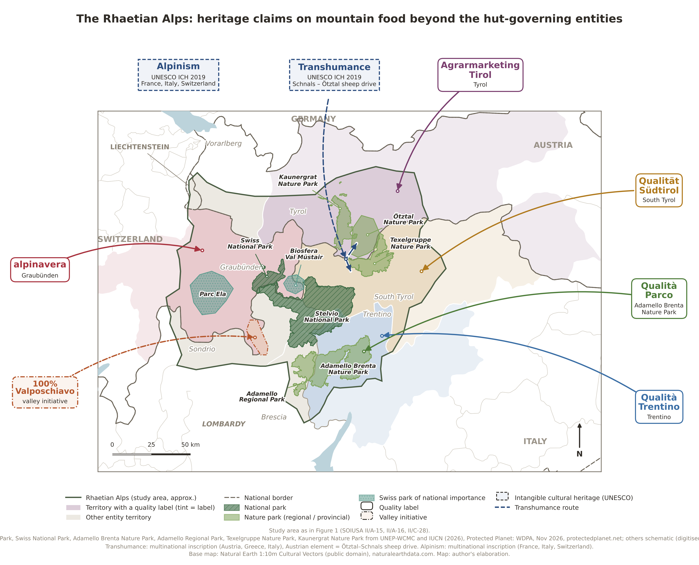

# Mappa Retiche – heritage claims

Source code for the map **The Rhaetian Alps: heritage claims on mountain food beyond the hut-governing entities**
(PhD thesis, *Food Heritage: Cultures and Identities*, University of Coimbra).



It is a companion to the study-area map (Figure 1), deposited separately:
Marcolla, S. V., *Mappa Retiche*, Zenodo, https://zenodo.org/records/23732494.
It uses the same extent, projection, study-area outline and base map, and adds the actors besides the eight
hut-governing entities that also claim mountain food in the area as heritage:

- protected areas: Stelvio and Swiss National Parks; Adamello Brenta, Adamello, Texelgruppe, Ötztal and Kaunergrat
  nature parks; Biosfera Val Müstair and Parc Ela;
- quality labels: alpinavera (Graubünden), Agrarmarketing Tirol, Qualität Südtirol, Qualità Trentino, and the
  park-level Qualità Parco (Adamello Brenta);
- a valley initiative: 100% Valposchiavo;
- intangible cultural heritage inscribed by UNESCO (2019): transhumance (Ötztal–Schnals sheep drive) and alpinism.

## Contents

| Path | What it is |
|---|---|
| `heritage_map.py` | The map script. Settings (parks, labels, colours) are in its CONFIG section. |
| `rhaetian_map.py` | The Figure 1 script, included because `heritage_map.py` imports its base settings (outline, territories, projection). |
| `tools/fgdb.py` | Pure-Python reader for ESRI File Geodatabase polygon tables (no GDAL needed). |
| `tools/wdpa_to_parks.py` | Builds the protected-area boundary file from Protected Planet (WDPA) .gdb downloads. |
| `ne_data/` | Natural Earth 1:10m boundaries, trimmed to the Alpine area. |
| `output/` | The rendered map (PDF, PNG at 300 dpi, SVG). |

## Running it

```bash
pip install -r requirements.txt
# optional: exact park boundaries from WDPA downloads (not included, see below)
python tools/wdpa_to_parks.py path/to/WDPA_..._Public_<id>.gdb [...] --out output/parks_wdpa.geojson
cd output
python ../heritage_map.py ../ne_data --parks parks_wdpa.geojson
```

Without `--parks`, all protected areas are drawn from schematic outlines in the script. Parks missing from the
boundary file keep their schematic outline, and the source line on the map states which are which.

## Method notes

- **Protected areas.** Exact boundaries from the WDPA where available (Stelvio, Swiss National Park, Adamello Brenta,
  Adamello, Texelgruppe, Kaunergrat in version 1.0); the others are schematic outlines digitised by hand (a few km).
  The Ötztal Nature Park is an umbrella over five protected areas (Naturpark Ötztal factsheet, 2017) and is drawn as
  their union. Overlapping Natura 2000, inventory and UNESCO-MAB records are excluded.
- **Quality labels.** Territorial labels tint their territory; Qualità Parco points to its park.
- **Transhumance.** The route shows the Schnals–Ötztal sheep drive, Austria's element of the 2019 multinational
  inscription (Austria, Greece, Italy). Alpinism (France, Italy, Switzerland, 2019) has no single location.

## Sources and licences

- Base map: Natural Earth 1:10m Cultural Vectors, public domain.
- Protected areas: UNEP-WCMC and IUCN (2026), *Protected Planet: The World Database on Protected Areas (WDPA)*
  [On-line], November 2026, Cambridge, UK: UNEP-WCMC and IUCN. Available at: www.protectedplanet.net.
  The WDPA licence forbids redistribution, so the boundary data are **not** included; download them from
  protectedplanet.net and rebuild with `tools/wdpa_to_parks.py`.
- Study area: Marazzi, S. (2005). *Atlante orografico delle Alpi. SOIUSA*. Priuli & Verlucca.
- Code: GNU GPL v3 or later (see `LICENSE`).
