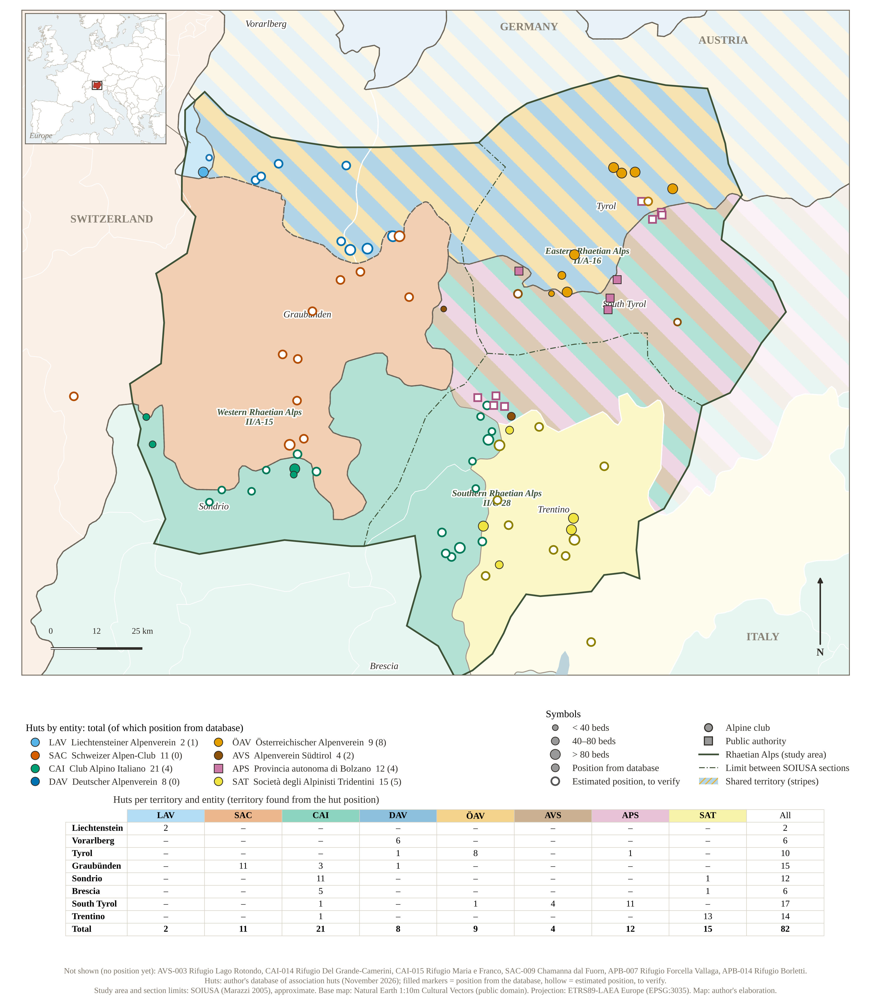

# Mappa Retiche – mountain huts

Source code and data for the map **The Rhaetian Alps: mountain huts of the hut-governing entities**
(PhD thesis, *Food Heritage: Cultures and Identities*, University of Coimbra).



It is a companion to the study-area map (Figure 1, `rhaetian_map.py`) on the same base: study area and
SOIUSA section limits, territories coloured by the entity operating huts there (striped where shared),
ETRS89-LAEA projection. It adds one marker per hut of the eight hut-governing entities:

- **colour** = entity; **circle** = alpine club, **square** = public authority;
- **size** = beds (< 40, 40–80, > 80);
- **filled** = position from the hut database; **hollow** = estimated position, still to be verified;
- a **table** of huts per territory and entity, with the territory found from each hut's position.

## Contents

| Path | What it is |
|---|---|
| `huts_map.py` | The map script. Settings (frame, marker sizes, table) are in its CONFIG section. |
| `rhaetian_map.py` | The Figure 1 script, imported for the shared base (outline, territories, projection, colours). |
| `data/huts.csv` | One row per hut: ID, names, entity, section, country, region, mountain group, altitude, beds, provisioning, access, status, scope, latitude, longitude, `coord_source`. |
| `tools/huts_from_workbook.py` | Builds `data/huts.csv` from the hut workbook (sheet "Association Huts"). |
| `ne_data/` | Natural Earth 1:10m boundaries (trimmed) and a simplified Europe layer for the locator. |
| `output/` | The rendered map (PDF, PNG at 300 dpi, SVG). |

## Running it

```bash
pip install -r requirements.txt
python tools/huts_from_workbook.py path/to/Raetian_Alps_COMBINED.xlsx --out data/huts.csv   # optional: rebuild data
cd output
python ../huts_map.py ../ne_data
```

## Data notes

- **Coordinates.** `coord_source` says where each position comes from: `workbook` (from the hut database,
  decimal or degrees-minutes-seconds), `estimate` (approximate position, ±1–2 km, estimated with AI assistance
  from general knowledge; **to be verified against the entity's official hut page before publication**), or
  `missing` (not drawn; listed on the map). One workbook latitude typed as 6° was corrected to 46°.
- **Same hut under two entities.** Heidelberger Hütte (DAV / SAC), Müllerhütte – Cima Libera (APB / ÖAV) and
  Rifugio Città di Milano (CAI / APB) appear twice in the database; they are drawn side by side.
- **Territory counts** use Natural Earth 1:10m boundaries, so huts within about a kilometre of a border
  (e.g. on the Bernina or Ötztal ridges) may be counted in the neighbouring territory.
- **Completeness.** The database is partial for several entities (see its sheet "Data Sources & Completion
  Guide"); counts describe the database, not the full hut networks.
- **Privacy.** The public CSV keeps no names, e-mails or phone numbers of hut keepers or managers.

## Sources and licences

- Huts: author's database of association huts (November 2026), compiled from the entities' official websites.
- Study area and section limits: Marazzi, S. (2005). *Atlante orografico delle Alpi. SOIUSA*. Priuli & Verlucca.
- Base map: Natural Earth 1:10m Cultural Vectors, public domain.
- Code: GNU GPL v3 or later (see `LICENSE`).
